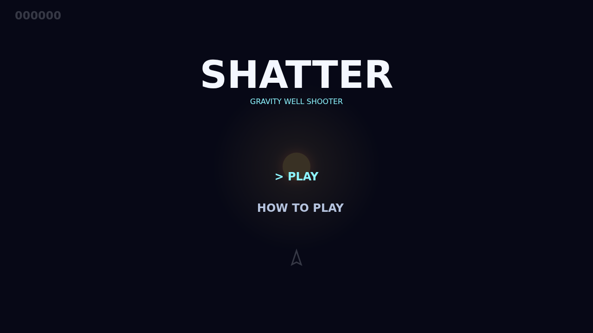

# Shatter

Shatter is a fast gravity-well rock shooter played on one endlessly wrapping
field. Pilot a small ship with momentum, turn through the dark, and send shots
into the star's pull.

Each wave begins with armored large rocks. Keep firing until they split into
medium and small fragments, then clear every last piece before the next wave
arrives faster and denser. A hunting saucer eventually crosses the field and
fires back.

The star is the trick. It bends every ballistic shot and rock, while the ship
and torpedo fly true. Curve gunfire around the bright core to reach a rock from
the far side, or spend the single guided torpedo to destroy any rock outright.
If the star swallows a rock it returns from an edge, keeping every wave moving.

